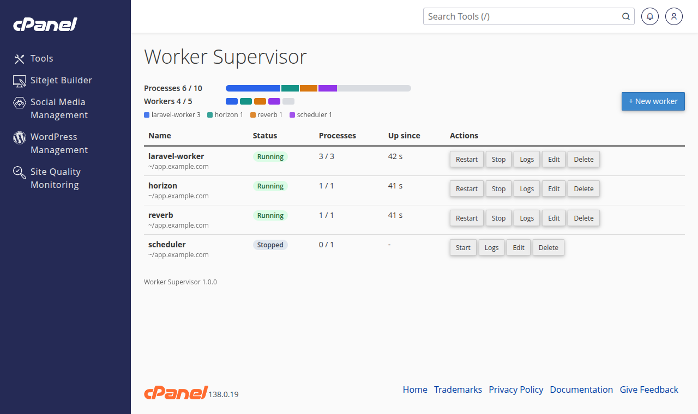
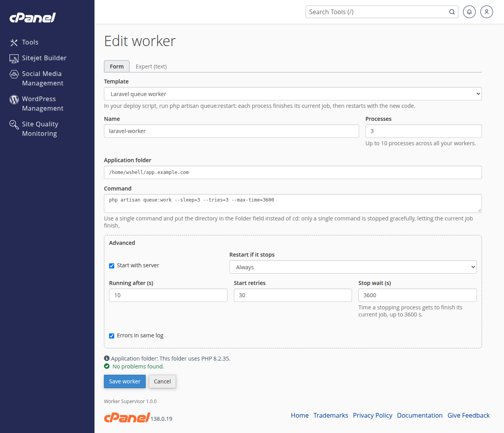
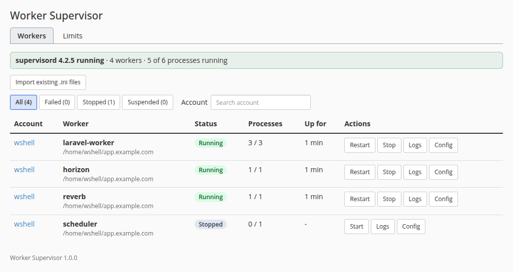

# Worker Supervisor

A cPanel/WHM plugin that lets cPanel clients create, start, stop and monitor their own supervisord background workers (Laravel queues, Horizon, Symfony Messenger, any long-running command) from cPanel or over SSH. Workers run as the account, inside its CloudLinux CageFS and LVE, under the server's supervisord. Root decides who gets the feature and how much, sees every worker in WHM, and can bring existing hand-written supervisor programs under the plugin.



| Editing a worker (cPanel) | Every worker on the server (WHM) |
|---|---|
|  |  |

The design spec lives in `docs/superpowers/specs/`, the implementation plan in `docs/superpowers/plans/`.

## Requirements

- cPanel & WHM with the Jupiter theme, on CloudLinux 8 or 9 with LVE and CageFS. The installer refuses anything else.
- Only CloudLinux 9 (cPanel 11.138) has been tested so far; CloudLinux 8 is untested until a CloudLinux 8 VM run is done.
- cPanel updates leave it in place: after `upcp --force` every plugin file was unchanged and running workers kept running.
- supervisor: installed by the installer with `dnf` (EPEL, enabled on CloudLinux) if missing, and enabled.

## Install, upgrade, uninstall

As root, keep a copy of the release on the server (the uninstaller runs from it):

```sh
git clone --branch v1.1.1 https://github.com/dansleboby/worker-supervisor.git /root/worker-supervisor
cd /root/worker-supervisor
./install.sh
```

Without git: `curl -L https://github.com/dansleboby/worker-supervisor/archive/refs/tags/v1.1.1.tar.gz | tar xz`, then run `./install.sh` from `worker-supervisor-1.1.1/`.

**Every account can use it as soon as it is installed.** cPanel turns a plugin feature on in every feature list that does not turn it off, so any account can create workers right after `./install.sh` (the installer prints this reminder). To restrict it, open WHM > Packages > Feature Manager and turn "Worker Supervisor" off in the feature lists that should not have it, or in the special "disabled" list to turn it off for every account. Accounts that lose the feature have their workers stopped within 5 minutes.

Re-running `./install.sh` from a newer copy upgrades in place. It registers the cPanel page and feature, the WHM page, the package extension, the UAPI module, the account hooks and a cron job. It refuses a `/etc/supervisord.conf` whose `[include]` does not load `supervisord.d/*.ini`, where the generated programs go.

cPanel has no version tracking or update channel for third-party plugins, so upgrades are manual. The installer prints the version it replaced; the installed version is also shown at the bottom of the cPanel and WHM pages and by `/usr/local/cpanel/3rdparty/worker_supervisor/bin/wsv --version`. Releases are listed in `CHANGELOG.md`.

```sh
cd /root/worker-supervisor
git fetch --tags && git checkout vX.Y.Z
./install.sh
```

```sh
./uninstall.sh                 # stop and remove every worker; keep the data and logs
./uninstall.sh --purge         # also delete /var/cpanel/worker_supervisor and /var/log/worker_supervisor
./uninstall.sh --keep-workers  # leave the workers running under supervisord, unmanaged
```

- Run it from a copy of the repository: `uninstall_plugin` reads `cpanel/install.json`.
- Workers are stopped gracefully, eight at a time, so the uninstall may wait as long as their "stop wait".
- It is safe to run again: every step skips what is already gone, and a failed step is reported (exit 1) without stopping the others.
- The extension is removed from every package that lists it, together with its keys in the accounts on those packages.
- Without `--purge`, a later `./install.sh` brings the stored workers back at once. `--purge` also deletes the backups of imported files.
- `--keep-workers` keeps the programs in `/etc/supervisord.d/`, their launcher (`bin/wsv-run`) and the data, so they keep running and restarting; nothing manages them (no suspend, no limits) until the next install. It cannot be combined with `--purge`.
- supervisor itself stays installed and running: other programs may use it.

## Enabling it for accounts

1. **Feature:** WHM > Packages > Feature Manager lists "Worker Supervisor", on in every feature list after install (see above). Accounts whose feature list allows it see cPanel > Advanced > Worker Supervisor; turning it off stops the workers of those accounts within 5 minutes, and turning it back on brings them back to their previous state.
2. **Limits:** WHM > Packages > Add/Edit a Package has a "Worker Supervisor" section: max processes (all workers of the account combined), max workers, max stop wait, and the templates the package may use. Packages without these values use the server defaults (10 processes, 5 workers, 3600 s, every template). A value of 0 means none, not unlimited: with 0 max workers, max processes or max stop wait the account cannot save any worker.
3. **Server defaults and per-account overrides:** WHM > Plugins > Worker Supervisor > Limits. Limits on packages owned by a reseller are ignored (server defaults apply); resellers have no control in this version.

CPU and memory are not plugin limits: workers run inside the account's LVE, which caps them. Moving an account to a smaller package keeps its running workers; the client cannot add or grow workers until back under the limits.

## For clients

cPanel > Advanced > Worker Supervisor lists the workers with their status, processes and actions (start, stop, restart, logs, edit, delete). A worker is created from a template, in a simple form, an advanced form (autostart, "Restart if it stops", start seconds, retries, stop wait, separate error log) or an expert text mode (a `[program:x]` block limited to those keys).

| Template | Command | Needs in the folder |
|---|---|---|
| Laravel queue worker | `php artisan queue:work --sleep=3 --tries=3 --max-time=3600` | `artisan` |
| Laravel Horizon | `php artisan horizon` (1 process) | `artisan`, `vendor/laravel/horizon` |
| Symfony Messenger | `php bin/console messenger:consume async --time-limit=3600` | `bin/console` |
| Custom command | any command | - |

`php` is the account's PHP as selected in MultiPHP for that folder.

**Restarting workers on deploy.** Ask the framework to stop its workers after the new code is in place; supervisord starts them again with the new code, provided "Restart if it stops" is "Always" (the default):

| Template | Deploy step |
|---|---|
| Laravel queue worker | `php artisan queue:restart` |
| Laravel Horizon | `php artisan horizon:terminate` |
| Symfony Messenger | `php bin/console messenger:stop-workers` |
| Custom command | `uapi WorkerSupervisor restart_worker name=<worker>` |

**Graceful stop** is guaranteed for a single command: it replaces the shell, receives supervisord's TERM itself and gets the full stop wait. Compound commands (`a && b`, `cd dir && cmd`) also run, but bash stays in front and supervisord considers the worker stopped as soon as bash exits. Put the directory in the Folder field instead of `cd ... &&`, and keep the command a single command.

**SSH and scripts.** The same actions, with the same permissions and limits, are a UAPI module:

```sh
uapi WorkerSupervisor list_workers
uapi WorkerSupervisor restart_worker name=laravel-worker
uapi WorkerSupervisor get_logs name=laravel-worker process=0 stream=out lines=200
```

Functions: `list_workers`, `get_worker`, `validate_worker`, `save_worker`, `delete_worker`, `start_worker`, `stop_worker`, `restart_worker`, `get_logs`, `clear_logs`, `list_templates`. Inside CageFS use `/usr/bin/uapi` (the CageFS proxy); root can call any account with `uapi --user=<account> WorkerSupervisor ...`.

## For root

WHM > Plugins > Worker Supervisor > Workers shows supervisord's health and every worker on the server (filters: all, failed, stopped, suspended; search by account), with logs, the generated config, and start, stop and restart. A worker root stops becomes "Stopped by administrator": the client sees it but cannot start it until root releases it.

**Account events** are handled by cPanel hooks:

- Suspend: the account's workers stop and show as suspended; unsuspend returns them to their previous state.
- Terminate: the workers stop before the removal; once the account is gone, its workers, data and logs are removed.
- Username change: workers, program names, logs and data follow the new name, and stored folders under the old home are rewritten to the new home. Absolute old-home paths inside commands are not rewritten.
- Package change: limits are checked again.

Workers belong to the cPanel account that created them, recorded as its uid and its creation date (`STARTDATE`, which a username change keeps), not to the username. When hooks were missed and the name now belongs to another account (a new account given the name of a removed one, or a stale username change), that account never sees, starts or inherits them: they are held, every reconcile logs an error, and the data stays for root. To discard it, delete `/var/cpanel/worker_supervisor/accounts/<account>.json` and the `<account>.json.renaming` or `.removing` marker next to it, if any; the next reconcile removes its programs.

`wsv reconcile` runs every 5 minutes from `/etc/cron.d/worker_supervisor` and repairs what the hooks cannot see (feature list edits have no hook) or missed. It also stops a worker that runs although it must not (supervisorctl jobs for a program run one at a time, but not necessarily in the order they were sent) and loads programs supervisord lost. It and the hooks log to syslog with the tag `worker_supervisor`:

```sh
journalctl -t worker_supervisor
```

**Backups and restores.** An account's workers are part of its cPanel account backup: a pkgacct component adds them to the archive as `worker_supervisor.json`, in WHM backups, transfers, the client's own full backup and JetBackup 5 (whose account configuration is built with pkgacct). Restoring the account (WHM Backup Restoration, `restorepkg`, Transfer Tool or a JetBackup restore that includes the account configuration) brings them back as they were, through a `PkgAcct::Restore` hook:

- The account's workers become those of the backup: missing ones are created, changed ones updated, ones created after the backup deleted; identical ones keep running untouched. Stopped workers stay stopped and admin stops are kept.
- Folders under the backup's home move to the account's home, so a restore under another username or home path works. Paths inside commands are not rewritten.
- Each worker goes through the same checks as a client save, against the limits of the server it is restored on: one refused for its limits or template is skipped and logged. Per-account overrides set in WHM are server settings, not part of the archive: after restoring a removed account, set its override again before the restore if its workers need it.
- A worker whose folder does not exist yet waits (`/var/cpanel/worker_supervisor/accounts/<account>.json.restoring`) and reconcile adds it once the folder is there, for up to 24 hours; it only ever goes to the account it was restored into. JetBackup restores the home directory after the account configuration, so after a JetBackup restore of a removed account the workers come back within 5 minutes.
- The plugin must be installed on the server that makes the backup and on the one that restores it. A JetBackup restore of the home directory alone does not touch the workers.

**Importing hand-written programs.** The "Import existing .ini files" button of the Workers page lists the programs in `/etc/supervisord.d/*.ini`. Pick one and the owning account, review the changes (the `su` wrapper replaced by the launcher, the folder taken from the `cd`, logs moved, `user=` dropped), then apply: the worker becomes managed and the original file is kept in `/var/cpanel/worker_supervisor/backups/`. A hand-written file supervisor cannot load (for example a program name with a space) makes `supervisorctl reread` and `update` fail for every program, managed ones included, so no worker can be saved, started or restarted until it is fixed or removed.

## Security model

The client is untrusted; root-side code accepts a fixed set of actions with validated arguments and enforces every limit itself.

- **Execution:** supervisord runs a root-owned launcher that starts the command as the account through `cagefs_enter_user --no-fork <account> /bin/bash -lc ...` with a clean environment. The launcher refuses (exit 64, reason in the worker's log) an account that is suspended, a worker root holds (a root-only `<worker>.hold` file next to its launch file, present while it is suspended, stopped by administrator, feature off or being removed), and a launch file stored for another uid than the account's. The worker lands in the account's CageFS and LVE and is supervisord's direct child, so `stopasgroup`/`killasgroup` reach all its processes and the stop wait is honoured. `su -` is not used: it cuts jobs off after about 2 seconds and orphans children. An account with `noshell` gains nothing it could not already do through cron inside CageFS.
- **Client text never reaches supervisord's config parser:** the generated `/etc/supervisord.d/wsv_<account>_<worker>.ini` holds only validated names, numbers and fixed values. Folder and command live in a root-only launch file the launcher reads, so supervisord never splits or `%`-expands them, and no `directory=` points into the client's home.
- **Logs** are written by supervisord in `/var/log/worker_supervisor/<account>/`, outside the home, so a client cannot turn a log into a symlink to a system file; clients read them only through the plugin. Rotation: 10 MB, 3 backups per log. They do not count against the account's disk quota (see Known limits).
- **Tools root runs** (supervisorctl, whmapi1, lvectl) get a fixed `PATH` and `LANG`, never the caller's environment.
- **Validation:** worker names are short lowercase slugs; folders must resolve inside the account's home with no symlink escape; numbers stay within the limits; expert mode accepts only an allow-list of keys.
- "Stopped by administrator" is an operational control, not a security boundary: the client can run the same command through cron. To block an account for real, turn the feature off for it. Templates are a convenience, not a boundary either: every template runs the client's own code.

## Files

| Path | Content |
|---|---|
| `/usr/local/cpanel/3rdparty/worker_supervisor/` | core (PHP, run with cPanel's PHP), `bin/wsv`, launcher `bin/wsv-run`, translations |
| `/var/cpanel/worker_supervisor/` | worker definitions per account (and restores waiting for their folder), launch and hold files, settings, import backups |
| `/var/log/worker_supervisor/<account>/` | worker logs |
| `/etc/supervisord.d/wsv_*.ini` | generated programs; do not edit, they are rewritten |
| `/run/worker_supervisor/` | one lock file per program, which keeps its supervisorctl jobs one at a time (tmpfs, recreated as needed) |
| `/usr/local/cpanel/Cpanel/API/WorkerSupervisor.pm`, `/var/cpanel/perl/Cpanel/Admin/Modules/WorkerSupervisor/` | UAPI module and the admin module that runs the core as root |
| `/usr/local/cpanel/base/frontend/jupiter/worker_supervisor/` | cPanel pages |
| `/usr/local/cpanel/whostmgr/docroot/cgi/worker_supervisor/` | WHM pages (AppConfig `worker_supervisor`) |
| `/var/cpanel/packages/extensions/worker_supervisor{,.tt2}` | package extension |
| `/usr/local/cpanel/3rdparty/bin/worker_supervisor_hook` | account hooks (7 Whostmgr `Accounts::*` registrations and `PkgAcct::Restore` post) |
| `/var/cpanel/perl/Cpanel/Pkgacct/Components/WorkerSupervisor.pm` | pkgacct component that adds the workers to account backups |
| `/etc/cron.d/worker_supervisor` | reconcile every 5 minutes |

## Known limits

- **Memory limit kills are not reported as such.** The LVE memory limit (PMEM, 1024 MB for the test account) is enforced by the kernel: a worker that exceeds it is killed with SIGKILL. supervisord only sees `terminated by SIGKILL; not expected` in its log. Observed with a worker that allocates without bound: it dies about 1.5 s after each spawn, so it never lasts `startsecs` (10 s) and never reaches RUNNING. Its state cycles STARTING -> BACKOFF (`Exited too quickly`) with growing delays between attempts, until `startretries` (30) is exhausted (FATAL expected then; not waited for). The restart counter is not exposed by `supervisorctl status`. A worker that survives `startsecs` before being killed would instead show RUNNING -> EXITED/STARTING and restart per `autorestart`.
- A memory kill in one worker does not touch the account's other workers: an `idle` worker (`sleep 3600`) kept RUNNING with an unchanged pid throughout.
- Graceful stop is only guaranteed for a single command (see above).
- **Logs are outside the account's disk quota.** Each process keeps up to 40 MB per stream (10 MB plus 3 backups), so an account can fill up to max processes x 2 streams x 40 MB of `/var/log` (800 MB with the default 10 processes).
- After a username change or an import, the old and new processes can run side by side for up to the stop wait, while the old ones finish their graceful stop. Harmless for queue workers; a daemon that binds a port may fail to start (FATAL) and need a restart.
- Horizon starts its own children, which the process count and limits cannot see.
- A username change does not rewrite absolute paths to the old home inside commands.
- Resellers have no control over limits or workers in this version.
- The cPanel home icon label stays in English for French users.
- Only CloudLinux 9 has been tested.

## Development

```sh
composer install
vendor/bin/phpunit             # or: composer test
```

The VM tests run on a local CloudLinux 9 + cPanel QEMU VM managed by `dev/vm/vm.sh` (`start`, `stop`, `status`, `ssh [cmd]`, `whm [account]`, `snapshot <name>`, `restore <name>`, `snapshots`); WHM is on https://127.0.0.1:2087 and cPanel on https://127.0.0.1:2083. The VM tests expect the accounts `wshell` (with shell) and `wnoshell` (without).

```sh
dev/deploy.sh                                          # copy the working tree to the VM and run install.sh there
dev/vm/vm.sh ssh 'bash -s' < tests/vm/launcher.sh     # LAUNCHER OK
dev/vm/vm.sh ssh 'bash -s' < tests/vm/uapi.sh         # UAPI OK
dev/vm/vm.sh ssh 'bash -s' < tests/vm/backup.sh       # BACKUP OK (removes and restores wshell; JetBackup part when installed)
tests/vm/clean-install.sh                              # CLEAN INSTALL OK
```

To release, set the new semantic version in `VERSION` (`tests/Unit/VersionTest.php` and `install.sh` reject anything else), add it to `CHANGELOG.md`, update the version in the install commands above, commit, tag it `vX.Y.Z` and publish a GitHub release from the tag.

`tests/vm/clean-install.sh` restores the `cloudlinux-clean` snapshot (the VM's current state is lost: snapshot it first), creates the test accounts, installs, runs the VM tests, checks every uninstall mode and that nothing of the plugin remains, and reinstalls.

A dummy Laravel app for manual tests needs an `artisan` that is a PHP loop, not a shell script (the templates run `php artisan ...`):

```php
<?php while (true) { sleep(5); }
```

## Security

Report vulnerabilities privately, see `SECURITY.md`.

## License

MIT, see `LICENSE`.
